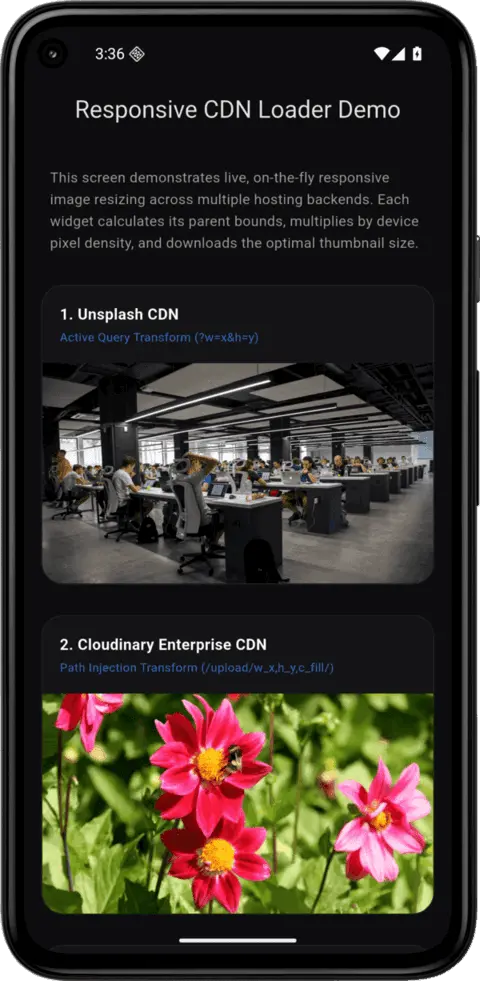

# responsive_cloud_image

[](https://pub.dev/packages/responsive_cloud_image)
[](https://pub.dev/packages/responsive_cloud_image)
[](https://github.com/hbsgujjar111/responsive_cloud_image/blob/master/LICENSE)



A lightweight, CDN-agnostic responsive image loader for Flutter. It automatically reads your layout
constraints and the device's physical pixel ratio (DPI) to request optimally resized, compressed
images directly from your database, cloud storage, or image delivery network (CDN).

---

## The Problem

Loading raw high-resolution images (4000 x 3000 px, 5 MB) inside small widgets (like a 100 x 100
profile avatar) causes severe performance penalties:

1. **Network waste:** Mobile users waste massive amounts of cellular data downloading large images.
2. **Memory bloat:** Decoding a 12-megapixel image into raw pixels uses over 48 MB of uncompressed
   RAM. In scrollable lists, this rapidly leads to **out of memory (OOM) app crashes**.

Writing custom string-manipulation queries (`?width=300`) across every single screen to fetch
smaller thumbnails requires massive, repetitive boilerplate code.

---

## The Solution

This package wraps standard image loading with automated layout observation and screen density
calculation. It determines the available width/height inside the rendering tree, converts those
logical points into physical device pixels, and formats the query parameters natively for the
specific cloud hosting provider you are using.

---

## Features

- **Automated constraint detection:** Observes container dimensions prior to making network
  requests.
- **Physical DPI multiplication:** Scales the requested image size by the device's screen density
  (for example it requests 300 px instead of 100 px on a 3x screen) to preserve visual sharpness.
- **Cache-friendly sizes:** Requested sizes are rounded up to a step (50 px by default) and capped
  to what each provider accepts, so resizing or animating a widget does not request a new image
  every frame.
- **Respects `BoxFit`:** `contain`, `cover`, `fill`, `fitWidth` and more select the matching crop or
  resize mode of each CDN.
- **Out-of-the-box CDN support:** Supabase, Appwrite, Cloudinary, Imgix, Unsplash, Shopify and
  Sanity.
- **Custom backends (Laravel, .NET):** Configure your own URL builder for self-hosted image
  endpoints.
- **Automatic fallback:** If the optimized image fails to load, the original URL is tried once
  before your error widget is shown.
- **Private buckets:** Send your own HTTP headers (for example `Authorization`) with every request.
- **Caching:** Powered by `cached_network_image` for disk caching on native platforms.

---

## Installation

Add the package dependency to your `pubspec.yaml` file:

```yaml
dependencies:
  responsive_cloud_image: ^1.1.0
```

Then run:

```bash
flutter pub get
```

Requires Dart 3.8 or newer (Flutter 3.32 or newer).

### Network permissions

Your app needs permission to reach the network:

- **Android:** add `<uses-permission android:name="android.permission.INTERNET"/>` to
  `android/app/src/main/AndroidManifest.xml`. (Debug builds have it by default, release builds do
  not.)
- **macOS:** add `com.apple.security.network.client` set to `true` in both
  `macos/Runner/DebugProfile.entitlements` and `macos/Runner/Release.entitlements`.
- **iOS, Windows, Linux, Web:** nothing to add. Plain `http://` URLs are blocked by default on
  iOS and Android, so use `https://`.

---

## Usage Examples

### 1. Unsplash or Imgix

```dart
import 'package:flutter/material.dart';
import 'package:responsive_cloud_image/responsive_cloud_image.dart';

class UnsplashImageExample extends StatelessWidget {
  const UnsplashImageExample({super.key});

  @override
  Widget build(BuildContext context) {
    return const ResponsiveCloudImage(
      imageUrl: 'https://images.unsplash.com/photo-1504384308090-c894fdcc538d',
      provider: CloudProvider.unsplash,
      fit: BoxFit.cover,
    );
  }
}
```

### 2. Supabase Storage

Supabase image transformations are available on paid plans only. Use the public object URL; signed
and authenticated URLs are shown unchanged (see the notes below).

```dart
import 'package:flutter/material.dart';
import 'package:responsive_cloud_image/responsive_cloud_image.dart';

class SupabaseImageExample extends StatelessWidget {
  const SupabaseImageExample({super.key});

  @override
  Widget build(BuildContext context) {
    return const ResponsiveCloudImage(
      imageUrl: 'https://yourproject.supabase.co/storage/v1/object/public/images/car.png',
      provider: CloudProvider.supabase,
      fit: BoxFit.cover,
    );
  }
}
```

### 3. Cloudinary (Path Transformations)

```dart
import 'package:flutter/material.dart';
import 'package:responsive_cloud_image/responsive_cloud_image.dart';

class CloudinaryImageExample extends StatelessWidget {
  const CloudinaryImageExample({super.key});

  @override
  Widget build(BuildContext context) {
    return const ResponsiveCloudImage(
      imageUrl: 'https://res.cloudinary.com/demo/image/upload/sample.jpg',
      provider: CloudProvider.cloudinary,
      fit: BoxFit.cover,
    );
  }
}
```

### 4. Custom Backends (Laravel, .NET, Node.js)

If your images are served by a custom database backend, set the provider to `CloudProvider.custom`
and supply a `customUrlBuilder` callback to format the request parameters exactly as your server
expects. The callback receives the final size in whole physical pixels. If it returns `null` or
throws, the original URL is used.

```dart
import 'package:flutter/material.dart';
import 'package:responsive_cloud_image/responsive_cloud_image.dart';

class CustomBackendImageExample extends StatelessWidget {
  const CustomBackendImageExample({super.key});

  @override
  Widget build(BuildContext context) {
    return ResponsiveCloudImage(
      imageUrl: 'https://my-laravel-app.com/api/v1/assets/profile.png',
      provider: CloudProvider.custom,
      customUrlBuilder: (url, width, height) {
        return '$url?width=${width.round()}&height=${height.round()}&crop=fit';
      },
      fit: BoxFit.cover,
    );
  }
}
```

### 5. Private buckets

```dart
import 'package:flutter/material.dart';
import 'package:responsive_cloud_image/responsive_cloud_image.dart';

class PrivateImageExample extends StatelessWidget {
  const PrivateImageExample({super.key, required this.token});

  final String token;

  @override
  Widget build(BuildContext context) {
    return ResponsiveCloudImage(
      imageUrl: 'https://api.example.com/photos/42.jpg',
      provider: CloudProvider.custom,
      customUrlBuilder: (url, width, height) => '$url?w=${width.round()}',
      httpHeaders: {'Authorization': 'Bearer $token'},
      semanticLabel: 'Profile photo',
    );
  }
}
```

On the web, the server must allow custom headers through CORS.

---

## Properties Table

These are the configurable parameters available on the `ResponsiveCloudImage` widget class:

| Parameter              | Type                                        | Default                 | Description                                                                                                         |
|:-----------------------|:--------------------------------------------|:------------------------|:--------------------------------------------------------------------------------------------------------------------|
| **`imageUrl`**         | `String`                                    | *Required*              | The original high-resolution raw source image URL.                                                                  |
| **`provider`**         | `CloudProvider`                             | `CloudProvider.generic` | The CDN or cloud storage provider hosting this image.                                                               |
| **`fit`**              | `BoxFit`                                    | `BoxFit.cover`          | How the image fits into its box. Also selects the CDN crop or resize mode. `BoxFit.none` disables URL optimization. |
| **`alignment`**        | `Alignment`                                 | `Alignment.center`      | How the image is aligned inside its box.                                                                            |
| **`sizeStep`**         | `int`                                       | `50`                    | Requested sizes are rounded up to a multiple of this many physical pixels. Use `1` for the exact size.              |
| **`maxDimension`**     | `int?`                                      | `null`                  | Caps the larger side of the request, in physical pixels.                                                            |
| **`customUrlBuilder`** | `String? Function(String, double, double)?` | `null`                  | Custom builder callback. **Required** only if `provider` is `CloudProvider.custom`.                                 |
| **`placeholder`**      | `Widget?`                                   | `null`                  | Displayed while the image is downloading. Defaults to a themed spinner.                                             |
| **`errorWidget`**      | `Widget?`                                   | `null`                  | Displayed if the image fails to load, after the original URL was tried once.                                        |
| **`httpHeaders`**      | `Map<String, String>?`                      | `null`                  | Headers sent with every image request.                                                                              |
| **`semanticLabel`**    | `String?`                                   | `null`                  | Text announced by screen readers.                                                                                   |

### How the size is chosen

- The image fills the largest box its parent allows. With an unbounded width the screen width is
  used, and with an unbounded height a 4:3 box derived from the width is used.
- The box is multiplied by the device pixel ratio, rounded up to `sizeStep`, then scaled down
  (keeping the aspect ratio) so the larger side stays within the provider limit and `maxDimension`.
- While the box has no area, nothing is requested.

---

## Supported Cloud Providers

| Provider Enum              | Transformation applied                                                                   | Size limit                           |
|:---------------------------|:-----------------------------------------------------------------------------------------|:-------------------------------------|
| `CloudProvider.supabase`   | `/object/public/` becomes `/render/image/public/`, plus `?width=x&height=y&resize=cover` | 2500 px                              |
| `CloudProvider.appwrite`   | `?width=x&height=y&gravity=center` (preview URLs)                                        | 4000 px                              |
| `CloudProvider.cloudinary` | Injects path transformations (`/upload/w_x,h_y,c_fill/...`)                              | 4096 px                              |
| `CloudProvider.imgix`      | `?w=x&h=y&fit=crop`                                                                      | 4096 px                              |
| `CloudProvider.unsplash`   | `?w=x&h=y&fit=crop`                                                                      | 4096 px                              |
| `CloudProvider.shopify`    | Injects the size into the file name (`image_300x300.jpg`)                                | 4096 px                              |
| `CloudProvider.sanity`     | `?w=x&h=y&fit=crop`                                                                      | 4096 px                              |
| `CloudProvider.custom`     | Executes your `customUrlBuilder` callback                                                | 4096 px (change with `maxDimension`) |
| `CloudProvider.generic`    | Serves the original unaltered URL                                                        | none                                 |

### How `fit` maps to each provider

| `BoxFit`          | Supabase `resize` | Appwrite               | Cloudinary `c_` | Imgix, Unsplash, Sanity `fit` | Shopify      |
|:------------------|:------------------|:-----------------------|:----------------|:------------------------------|:-------------|
| `cover` (default) | `cover`           | width, height, gravity | `fill`          | `crop`                        | `_WxH`       |
| `contain`         | `contain`         | width only             | `fit`           | `clip`                        | `_WxH`       |
| `scaleDown`       | `contain`         | width only             | `limit`         | `max`                         | `_WxH`       |
| `fill`            | `fill`            | width only             | `scale`         | `scale`                       | `_WxH`       |
| `fitWidth`        | width only        | width only             | `w_x,c_scale`   | `w` only                      | `_Wx`        |
| `fitHeight`       | height only       | height only            | `h_y,c_scale`   | `h` only                      | `_xH`        |
| `none`            | original URL      | original URL           | original URL    | original URL                  | original URL |

Shopify fits the image inside the requested box and never crops, so it uses the same suffix for
every mode except `fitWidth` and `fitHeight`.

### Notes

- **Supabase:** only public object URLs are transformed. Signed (`/object/sign/`) and authenticated
  (`/object/authenticated/`) URLs are used unchanged, because their access token fixes the
  transformation. Image transformations must be enabled for your project (paid plans).
- **Appwrite:** use the `/preview` URL. Other endpoints ignore the size parameters.
- **Signed CDN URLs** (for example Imgix URLs with an `s=` signature): adding size parameters
  invalidates the signature. Use `CloudProvider.generic`, or `CloudProvider.custom` with your own
  signing.
- **Fallback:** if the optimized request fails (for example the CDN rejects it), the original URL is
  requested once. That image is not resized, so it may be large.

---

## Platforms Supported

* iOS
* Android
* Web (including WebAssembly)
* macOS
* Windows
* Linux

---

## Contributions Welcome

Found a bug or want to improve this widget? Open an issue or pull request on GitHub:
[github.com/hbsgujjar111/responsive_cloud_image](https://github.com/hbsgujjar111/responsive_cloud_image)

---

## License

This project is licensed under the MIT License - see the [LICENSE](LICENSE) file for details.
