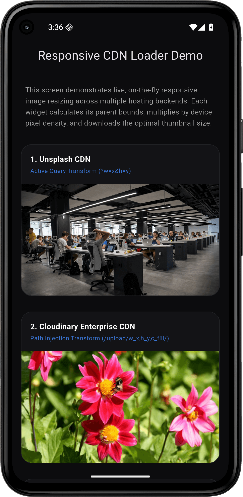

# responsive_cloud_image

[](https://pub.dev/packages/responsive_cloud_image)
[](https://pub.dev/packages/responsive_cloud_image)
[](https://github.com/hbsgujjar111/responsive_cloud_image/blob/master/LICENSE)



A lightweight, CDN-agnostic responsive image loader for Flutter. It automatically reads your layout
constraints and the device's physical pixel ratio (DPI) to request optimally resized, compressed
images directly from your database, cloud storage, or image delivery network (CDN).

---

## The Problem

Loading raw high-resolution images ($4000 \times 3000\text{ px}$, $5\text{MB}$) inside small
widgets (like a $100 \times 100$ profile avatar) causes severe performance penalties:

1. **Network Waste:** Mobile users waste massive amounts of cellular data downloading large images.
2. **Memory Bloat:** Decoding a 12-megapixel image into raw pixels uses over $48\text{MB}$ of
   uncompressed RAM. In scrollable lists, this rapidly leads to **Out of Memory (OOM) app crashes**.

Writing custom string-manipulation queries (`?width=300`) across every single screen to fetch
smaller thumbnails requires massive, repetitive boilerplate code.

---

## The Solution

This package wraps standard image loading with automated layout observation and screen density
calculation. It determines the available width/height inside the rendering tree, converts those
logical points into physical device pixels, and formats the query parameters natively for the
specific cloud hosting provider you are using.

---

## Features

- **Automated Constraint Detection:** Observes container dimensions prior to making network
  requests.
- **Physical DPI Multiplication:** Automatically scales requested image size based on the device's
  screen density (e.g. requests $300\text{px}$ instead of $100\text{px}$ on standard $3\text{x}$
  Retina screens) to preserve visual sharpness.
- **Out-of-the-Box CDN Support:** Supports Supabase, Appwrite, Cloudinary, Imgix, Unsplash, Shopify,
  and Sanity.
- **Custom Backends (Laravel, .NET):** Easily configure custom URL parsers for self-hosted image
  endpoints.
- **Production-Grade Caching:** Fully powered by `cached_network_image` for fluid offline cache
  management.

---

## Installation

Add the package dependency to your `pubspec.yaml` file:

```yaml
dependencies:
  responsive_cloud_image: ^1.0.0
```

Then run:

```bash
flutter pub get
```

---

## Usage Examples

### 1. Unsplash or Imgix

```dart
import 'package:flutter/material.dart';
import 'package:responsive_cloud_image/responsive_cloud_image.dart';

class UnsplashImageExample extends StatelessWidget {
  const UnsplashImageExample({super.key});

  @override
  Widget build(BuildContext context) {
    return const ResponsiveCloudImage(
      imageUrl: 'https://images.unsplash.com/photo-1504384308090-c894fdcc538d',
      provider: CloudProvider.unsplash,
      fit: BoxFit.cover,
    );
  }
}
```

### 2. Supabase Storage

```dart
import 'package:flutter/material.dart';
import 'package:responsive_cloud_image/responsive_cloud_image.dart';

class SupabaseImageExample extends StatelessWidget {
  const SupabaseImageExample({super.key});

  @override
  Widget build(BuildContext context) {
    return const ResponsiveCloudImage(
      imageUrl: 'https://yourproject.supabase.co/storage/v1/object/public/images/car.png',
      provider: CloudProvider.supabase,
      fit: BoxFit.cover,
    );
  }
}
```

### 3. Cloudinary (Path Transformations)

```dart
import 'package:flutter/material.dart';
import 'package:responsive_cloud_image/responsive_cloud_image.dart';

class CloudinaryImageExample extends StatelessWidget {
  const CloudinaryImageExample({super.key});

  @override
  Widget build(BuildContext context) {
    return const ResponsiveCloudImage(
      imageUrl: 'https://res.cloudinary.com/demo/image/upload/sample.jpg',
      provider: CloudProvider.cloudinary,
      fit: BoxFit.cover,
    );
  }
}
```

### 4. Custom Backends (Laravel, .NET, Node.js)

If your images are served by a custom database backend, set the provider to `CloudProvider.custom`
and supply a `customUrlBuilder` callback to format the request parameters exactly as your server
expects:

```dart
import 'package:flutter/material.dart';
import 'package:responsive_cloud_image/responsive_cloud_image.dart';

class CustomBackendImageExample extends StatelessWidget {
  const CustomBackendImageExample({super.key});

  @override
  Widget build(BuildContext context) {
    return ResponsiveCloudImage(
      imageUrl: 'https://my-laravel-app.com/api/v1/assets/profile.png',
      provider: CloudProvider.custom,
      customUrlBuilder: (url, width, height) {
        return '$url?width=${width.round()}&height=${height.round()}&crop=fit';
      },
      fit: BoxFit.cover,
    );
  }
}
```

---

## Properties Table

These are the configurable parameters available on the `ResponsiveCloudImage` widget class:

| Parameter              | Type                                        | Default                 | Description                                                                            |
|:-----------------------|:--------------------------------------------|:------------------------|:---------------------------------------------------------------------------------------|
| **`imageUrl`**         | `String`                                    | *Required*              | The original high-resolution raw source image URL.                                     |
| **`provider`**         | `CloudProvider`                             | `CloudProvider.generic` | The CDN or cloud storage provider hosting this image.                                  |
| **`fit`**              | `BoxFit`                                    | `BoxFit.cover`          | How the image fits into its layout constraints.                                        |
| **`customUrlBuilder`** | `String? Function(String, double, double)?` | `null`                  | Custom builder callback. **Required** only if `provider` is `CloudProvider.custom`.    |
| **`placeholder`**      | `Widget?`                                   | `null`                  | Displayed while the optimized network image is downloading.                            |
| **`errorWidget`**      | `Widget?`                                   | `null`                  | Displayed if loading or resizing fails. Falls back to the original image URL on error. |

---

## Supported Cloud Providers

| Provider Enum              | Transformation Format Applied                               |
|:---------------------------|:------------------------------------------------------------|
| `CloudProvider.supabase`   | Appends `?width=x&height=y&resize=cover`                    |
| `CloudProvider.appwrite`   | Appends `?width=x&height=y&crop=center`                     |
| `CloudProvider.cloudinary` | Injects path transformations (`/upload/w_x,h_y,c_fill/...`) |
| `CloudProvider.imgix`      | Appends `?w=x&h=y&fit=crop`                                 |
| `CloudProvider.unsplash`   | Appends `?w=x&h=y&fit=crop`                                 |
| `CloudProvider.shopify`    | Injects filename dimensions (`image_300x300.jpg`)           |
| `CloudProvider.sanity`     | Appends `?w=x&h=y&fit=crop`                                 |
| `CloudProvider.custom`     | Executes user-defined `customUrlBuilder` callback           |
| `CloudProvider.generic`    | Serves original unaltered URL                               |

---

## 💻 Platforms Supported

* iOS
* Android
* Web
* macOS
* Windows
* Linux

---

## 🤝 Contributions Welcome

Found a bug or want to improve this widget? Open an issue or pull request on GitHub:

*[github.com/hbsgujjar111/responsive_cloud_image](https://github.com/hbsgujjar111/responsive_cloud_image)

---

## License

This project is licensed under the MIT License - see the [LICENSE](LICENSE) file for details.